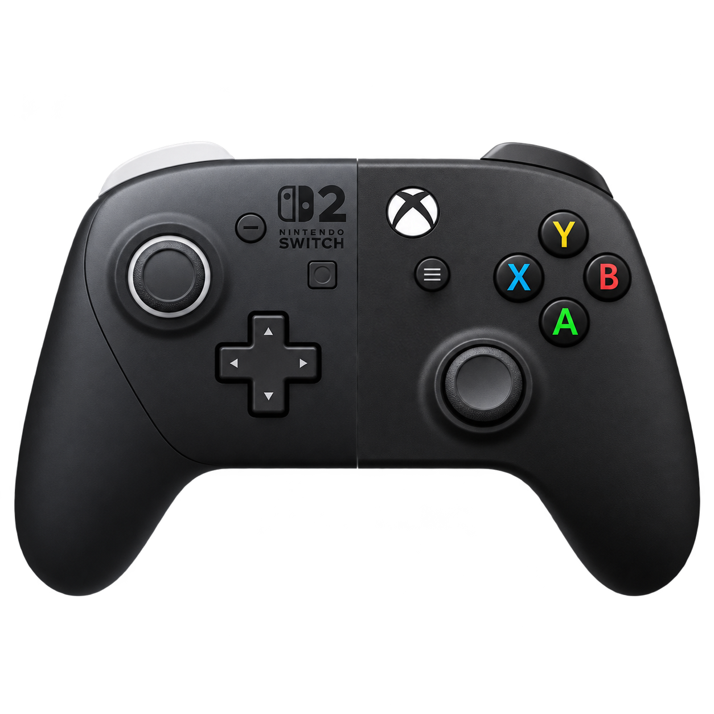

<p align="center">
  
</p>

<h1 align="center">Switch 2 Pro Bridge</h1>

<p align="center">Use a wired Nintendo Switch 2 Pro Controller on Windows as an Xbox controller.</p>

---

Plug the controller in with a USB cable and open the app. While the app runs, games see a standard Xbox 360 controller.

## Install

1. Download `Switch2ProBridge-Setup-<version>.exe` from [Releases](../../releases).
2. Run it. The installer also installs the [ViGEmBus](https://github.com/nefarius/ViGEmBus) driver, which creates the virtual Xbox controller. That's why it asks for admin rights.
3. Plug in the controller and open **Switch 2 Pro Bridge**.

## Features

- Starts the controller over USB automatically. You don't need a web tool.
- Maps buttons, sticks, D-pad and triggers by position (Switch B → Xbox A, and so on).
- Shows both controllers live, plus the battery level.
- Optionally stops the "ms-gamebar" pop-up Windows shows when Xbox Game Bar isn't installed.

## Limitations

- USB only. No Bluetooth.
- Triggers are digital (on or off).
- Capture, C, GL and GR aren't mapped yet.
- No rumble.
- Only one program can use the controller at a time. Close procon2tool, or any browser tab using WebUSB, first.

## Build from source

You need the [.NET 10 SDK](https://dotnet.microsoft.com/download) and, for the installer, [Inno Setup 6](https://jrsoftware.org/isinfo.php) (`winget install JRSoftware.InnoSetup`).

```powershell
# App only: produces publish\Switch2ProBridge.exe
dotnet publish Switch2ProBridge.App -c Release -o publish

# App + installer: produces dist\Switch2ProBridge-Setup-1.0.0.exe
.\build-installer.ps1 -Version 1.0.0
```

| Project | What it does |
| --- | --- |
| `Bridge.Core` | USB startup, input parsing, virtual Xbox output |
| `Switch2ProBridge.App` | WPF app |
| `Bridge.Probe` | Console tool that prints raw and decoded controller input |
| `tools/IconGen` | Builds `app.ico` from `assets/icon-source.png` |
| `installer` | Inno Setup script |

## Credits

- [procon2tool](https://handheldlegend.github.io/procon2tool/) by Hand Held Legend, for the USB startup sequence.
- [ViGEmBus](https://github.com/nefarius/ViGEmBus) and [ViGEm.Client](https://github.com/nefarius/ViGEm.NET) by Nefarius, for virtual controller emulation.

Not affiliated with Nintendo or Microsoft.
